# Clearpath AP — invoice in, payment decision out

A working accounts-payable desk for an Indian manufacturer (problem statement 1). Drop in a vendor invoice PDF, digital or scanned, and watch it go through 8 checks live. It comes out as one of four decisions:

- **approved**, with a payment proposal (TDS, MSME due date, journal entry);
- **partially approved**, paying only what's supported;
- **on hold**, routed to a named owner with a specific question;
- **rejected**, with a drafted email to the vendor.

Every exception lands in an inbox where a person resolves it, inside guardrails.

**Live app:** https://zamp-ai-khaki.vercel.app · **Demo video:** _(Loom link)_

> **AI reads, rules decide, humans resolve.**
> The model only does what needs judgment about messy pixels: reading the document. Every rupee decision comes from explicit rules you can audit, so each outcome can be explained to an auditor in one sentence. Every exception goes to a person with a precise question.

---

## What happens to one invoice

```mermaid
flowchart LR
  A[PDF / scan] --> B[1 Intake<br/>SHA-256, digital vs scan]
  B --> C[2 AI extraction<br/>Gemini → strict JSON schema]
  C --> D[3 Verify the AI<br/>text-layer grounding / 2nd read<br/>arithmetic, checksums]
  D --> E[4 Vendor & bank<br/>GSTIN, status, bank on file]
  E --> F[5 Duplicates<br/>normalised no., fuzzy]
  F --> G[6 PO · GRN · invoice<br/>3-way match, PO inference]
  G --> H[7 GST compliance<br/>IGST vs CGST+SGST]
  H --> I{8 Decision}
  I -->|Approved| J[Payment proposal<br/>TDS · MSME due date · JE]
  I -->|Partial / Rejected| K[Vendor email draft]
  I -->|On hold| L[Exceptions inbox<br/>owner + question]
  K --> L
  L --> M[Human resolves<br/>within guardrails · audit trail]
```



Each stage streams to the UI as it finishes, so you watch the invoice move through the pipeline. Every past run is kept on the dashboard. Click any run to see each check, the document with the verified values highlighted, and the full decision record.

## Edge cases it handles

| Case | What makes it hard | What the system does |
|---|---|---|
| **Split invoice overbills the PO** (demo 2) | Each invoice looks fine alone; only the *running total* across invoices against goods received is wrong | Pays the part backed by goods received, holds ₹43,000 + GST, and drafts a credit-note request |
| **Bank account changed** (demo 3) | A perfect invoice. The only red flag is new bank details plus "please update your records" — the most common invoice-fraud pattern (business email compromise) | Holds it for Treasury: call the vendor on the phone number already on file. It never emails the vendor and never pays the new account |
| **Scanned invoice, no PO number** (demo 4) | No text layer to check against, no PO to match | A second independent AI read must agree. The PO is inferred from line items and open quantities (score ≥ 0.75, clear margin over the runner-up) |
| **Disguised duplicate** (demo 5) | Re-sent as a scan, with a new number format (`SGS-2627-87` vs `SGS/26-27/0087`) and a new date | Normalised number + same amount + same PO → rejected as a duplicate of a paid invoice |
| Also: price over tolerance, goods short-received, wrong GST type, invalid GSTIN checksum, unknown or blocked vendor, GST-inclusive rates, arithmetic errors, missing invoice number, misread scan characters | | |

## Results

Every test invoice has a label: the decision a careful senior AP analyst would make. Each one is scored twice:
- **end-to-end:** the real AI reads the PDF;
- **rules only:** perfect data is fed in.

This separates a reading error from a logic error.

| Test set | Correct decisions when the AI answered | AI answered in time (free tier) | Rules only |
|---|---|---|---|
| Development (15 invoices: demos + targeted edge cases) | **15/15** | 15/15 | 15/15 |
| **Held-out (24 unseen invoices)** | **24/24** | 24/24 | 24/24 |

The held-out set ([scripts/holdout.py](scripts/holdout.py)) was built *after* the rules were frozen:
- a **layout never seen** during development;
- **reworded item names** (`"32A FP MCB C-type"` vs the PO's `"MCB 32A 4-Pole C-Curve"`);
- random quantities, prices, dates and scans;
- labels that come from the scenario, not from the rules engine.

When the AI doesn't answer in time, nothing is decided. The invoice waits in the inbox with a Retry button, and the miss is counted as availability, not as a correct answer.

Honest limits: all test invoices are synthetic (5 layouts, 6 suppliers, single page, one GST rate). Real supplier variety would be harder. The design holds whatever it can't verify instead of guessing.

## Design choices worth defending

- **The LLM never decides.** Its self-reported confidence is poorly calibrated, so confidence comes from *checks* instead:
  - **digital PDFs:** each critical value must literally appear in the PDF text layer;
  - **scans:** a second independent read must agree;
  - **always:** the document's own arithmetic must reconcile, and GSTIN/IFSC formats must validate.
- **OCR repair the auditor can check.** The GSTIN checksum is used as an error-correcting code: only confusable characters (O/0, I/1, S/5…) are tried, and a repair is accepted only when the checksum validates. The 5th character of an IFSC is always `0`. Every repair is shown in the run.
- **Hedged model calls.** The same request goes to 3 free Gemini models in parallel and the first valid answer wins (the "tail at scale" pattern). This took availability on the free tier from ~53% to ~93–100%.
- **Ranked outcomes:** Reject (the vendor must fix the document) › Hold (an internal owner must answer a question) › Partial (pay what's provably owed) › Approve. Partial approval keeps MSME suppliers paid on time instead of freezing the whole invoice.
- **Humans resolve, inside guardrails:**
  - **Allowed:** a reviewer can release a price hold or a verified bank change, with a written reason.
  - **Not allowed:** a reviewer *cannot* pay a duplicate, an un-onboarded or blocked vendor, or an invoice that would lose input tax credit. Those need the vendor or the master data fixed first.
  - **Audit trail:** the system's decision is never overwritten. The human decision is stored next to it with who, when and why.
- **India-specific rules:**
  - GSTIN mod-36 checksum;
  - intra-state → CGST+SGST, inter-state → IGST;
  - billed to our GSTIN; invoice serial number required (CGST Rule 46);
  - TDS 194Q / 194J / 194C on the taxable value;
  - MSME 45-day payment limit (MSMED Act s.15, IT Act s.43B(h)), with the exceptions inbox sorted by that deadline.

## Assumptions

- **The company:** the buyer is a Karnataka manufacturer, Kaveri Precision Components. Vendor master, POs, goods receipts (GRNs) and the AP ledger are synthetic but structurally realistic. See the *Procurement data* tab.
- **Fixed date:** the business date is fixed at 20 Nov 2026 so results are reproducible.
- **Invoice scope:** single-page invoices, one GST rate (18%).
- **TDS:**
  - 194Q at 0.1% assumes the ₹50L threshold is already crossed;
  - TDS is calculated on the taxable value, excluding GST.
- **PO balance:** held invoices don't reserve PO balance; approved or released quantities do.
- **Intake:** in production, invoices would arrive in an AP mailbox and the master data would be live reads from the ERP (Tally / SAP / Zoho). Here, intake is by upload or demo sample.

## Run it

```bash
python -m venv .venv && .venv/bin/pip install -r requirements.txt
echo "GEMINI_API_KEY=..." > .env              # free key from aistudio.google.com
.venv/bin/uvicorn app.main:app --port 8765    # → http://localhost:8765

.venv/bin/python -m scripts.evaluate --oracle                 # rules only, development set
.venv/bin/python -m scripts.evaluate                          # end-to-end, development set
.venv/bin/python -m scripts.evaluate --set holdout            # end-to-end, unseen set
```

**Deploy on Vercel:**
- Import the repo and set `GEMINI_API_KEY`.
- Optionally add Neon Postgres from the Storage tab (`DATABASE_URL`) so run history persists. Otherwise it falls back to SQLite.

| Path | What |
|---|---|
| [app/pipeline.py](app/pipeline.py) | Orchestrates the 8 stages and streams events |
| [app/extract.py](app/extract.py) | Gemini extraction, hedged calls, text-layer grounding, dual read, OCR repair |
| [app/rules.py](app/rules.py) | Rules engine: vendor, duplicates, 3-way match, PO inference, GST, decision, payment |
| [app/resolve.py](app/resolve.py) | Human resolution: allowed actions, guardrails, audit trail, MSME clock |
| [app/master.py](app/master.py) | Vendor master, POs, goods receipts, AP ledger, policy |
| [scripts/](scripts/) | Invoice generator, held-out set, evaluation harness |
| [public/](public/) | UI (plain HTML/CSS/JS, light and dark) |

## What I'd build next

1. **Mailbox intake:** with vendor-email reputation checks, which strengthens the bank-change control.
2. **ERP connector:** live vendor master, POs and goods receipts, and posting the journal entry back.
3. **Learning from resolutions:** if buyers keep releasing the same vendor's +3% price variance, suggest a PO amendment or a tolerance change. The rules stay explicit; only the suggestions are learned.
4. **Broader invoice support:** multi-page invoices and multiple GST rates per invoice.
